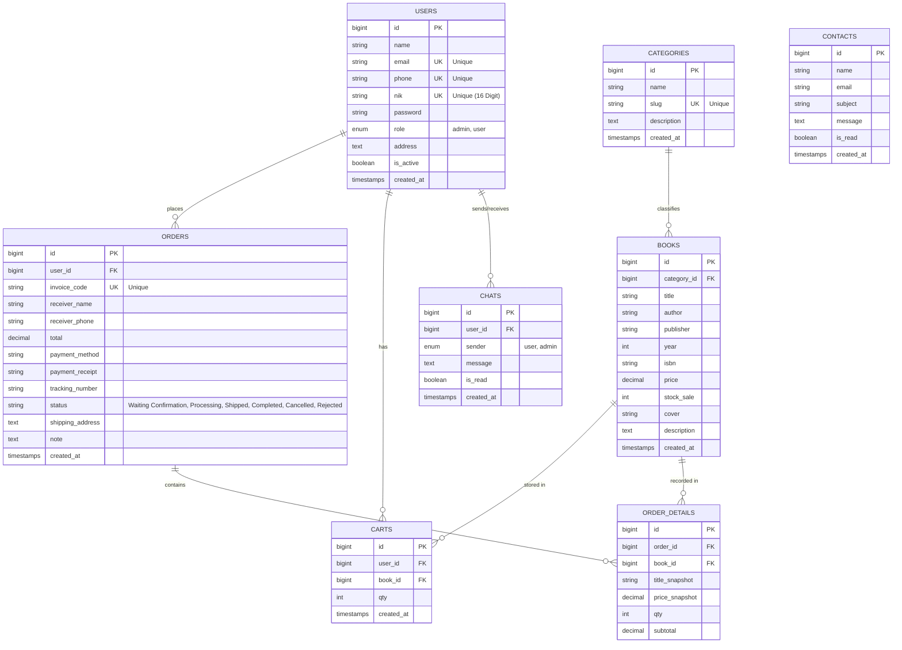
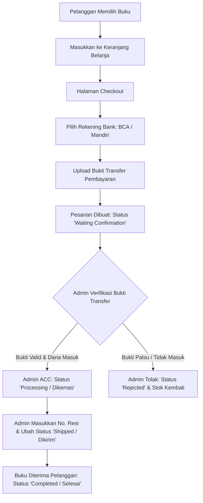

# 📚 PUSTAKAMART — Online Bookstore E-Commerce Platform

<p align="center">
  
</p>

<p align="center">
  <strong>Platform Toko Buku Online Modern Berbasis Laravel &amp; MySQL</strong><br>
  Solusi belanja buku fisik original, verifikasi pembayaran bukti transfer bank, pelacakan ekspedisi, dan livechat interaktif pelanggan-admin.
</p>

<p align="center">
  
  
  
  
  
</p>

---

## 🎨 Desain UI/UX (Figma Prototype)
Seluruh antarmuka pengguna (User & Admin) dirancang berdasarkan rancangan visual prototype resmi di Figma:
* 🔗 **Figma Project Design**: [Desain PUSTAKA-MART di Figma](https://www.figma.com/design/s1z7sQt0eEIfVH2ZMmfFEI/PUSTAKA-MART?node-id=0-1&p=f&t=XBuVDAfT4pT44wPe-0)

---

## 📌 Daftar Isi
1. [Tentang PustakaMart](#-tentang-pustakamart)
2. [Fitur Utama Sistem](#-fitur-utama-sistem)
3. [Arsitektur Database & Relasi](#-arsitektur-database--relasi)
4. [Alur Bisnis Transaksi (Order Workflow)](#-alur-bisnis-transaksi-order-workflow)
5. [Teknologi yang Digunakan (Tech Stack)](#-teknologi-yang-digunakan-tech-stack)
6. [Panduan Instalasi & Cara Clone](#-panduan-instalasi--cara-clone)
7. [Akun Pengujian Demo (Default Credentials)](#-akun-pengujian-demo-default-credentials)
8. [Struktur Direktori Proyek](#-struktur-direktori-proyek)
9. [Kesesuaian Standar Kompetensi BNSP JWD](#-kesesuaian-standar-kompetensi-bnsp-jwd)

---

## 📖 Tentang PustakaMart
**PustakaMart** adalah aplikasi web e-commerce penjualan buku fisik original yang dibangun dengan prinsip arsitektur **MVC (Model-View-Controller)** menggunakan framework **Laravel** dan basis data **MySQL**. 

Aplikasi ini dikembangkan untuk memenuhi seluruh standar Unit Kompetensi sertifikasi **BNSP Junior Web Developer (JWD)**, mencakup autentikasi multi-role, validasi data form yang ketat, pencegahan duplikasi data unik (*unique constraint*), pengelolaan relasi database relasional, transaksi atomik database dengan kunci stok (*database locking*), upload berkas digital, hingga komunikasi real-time interaktif.

---

## ✨ Fitur Utama Sistem

### 👤 1. Sisi Pengguna / Pelanggan (Customer Role)
* **Katalog Buku Responsif**:
  * Pencarian buku instan berdasarkan **Judul**, **Penulis**, atau nomor **ISBN**.
  * Filter berdasarkan **Kategori Buku** dan status ketersediaan stok.
  * Pengurutan (*sorting*) berdasarkan harga terendah, harga tertinggi, dan buku terbaru.
* **Keranjang Belanja Cerdas (Smart Shopping Cart)**:
  * Memilih item buku yang ingin di-checkout menggunakan checkbox multi-select.
  * Update kuantitas buku secara dinamis dengan proteksi stok terkini.
  * Otomatis mendeteksi buku yang habis stok dan memisahkannya ke daftar tidak dapat dibeli.
* **Checkout & Pembayaran Aman**:
  * Input data penerima, nomor WhatsApp/telepon aktif, dan alamat pengiriman lengkap.
  * Pilihan metode transfer bank resmi (**Bank BCA** & **Bank Mandiri**).
  * **Upload Bukti Transfer Pembayaran** (format JPG, PNG, WEBP, atau PDF hingga 10MB).
  * Proteksi *Race Condition* (*database lockForUpdate*) untuk memastikan stok tidak minus saat pembeli lain checkout bersamaan.
* **Riwayat Pesanan & Pelacakan Resi**:
  * Memantau status pesanan (*Menunggu Konfirmasi*, *Dikemas*, *Dikirim*, *Selesai*, *Dibatalkan*).
  * Pelacakan **Nomor Resi Ekspedisi** resmi saat buku dalam pengiriman kurir.
  * Fitur unggah ulang / ganti bukti transfer selama pesanan masih menunggu konfirmasi.
  * Fitur pembatalan pesanan mandiri sebelum barang dikirim.
  * **Cetak Struk / Invoice Pembelian** dalam format siap cetak (*print-friendly*).
* **LiveChat Interaktif Pelanggan - Admin**:
  * Konsultasi langsung dengan admin toko terkait stok buku, rekomendasi, dan status pengiriman.
* **Formulir Kontak Tamu (Contact Us)**:
  * Kirim saran, pertanyaan, atau masukan untuk toko PustakaMart.
* **Manajemen Profil Akun**:
  * Ubah nama, nomor telepon, NIK, alamat pengiriman default, dan ganti password akun.

---

### 🛡️ 2. Sisi Admin Toko (Administrator Role)
* **Dashboard Statistik Real-Time**:
  * Total Omzet / Pendapatan Penjualan Bersih.
  * Total Judul Buku & Total Stok Fisik Tersedia.
  * Total Transaksi Pesanan & Status Berjalan.
  * Total Pelanggan Terdaftar & Pesan Masuk / Chat Belum Dibaca.
* **Manajemen Data Buku Fisik (CRUD Katalog)**:
  * Tambah buku baru dengan validasi ketat (*Semua field wajib diisi: Judul, Penulis, Penerbit, Tahun Terbit 4 digit, ISBN, Kategori, Harga, Stok, Sinopsis, dan File Cover*).
  * Proteksi duplikasi judul buku kembar.
  * Filter status stok dinamis: *Semua Stok*, *Stok Tersedia (>0)*, dan *Stok Habis (0)* dengan counter data riil.
  * Ekspor katalog buku ke format **CSV** & **Cetak Laporan Buku**.
  * Proteksi hapus buku: Buku tidak dapat dihapus jika masih terkait transaksi pesanan berjalan.
* **Manajemen Kategori Buku**:
  * Tambah, edit, dan hapus kategori buku dengan slug URL otomatis.
  * Proteksi hapus kategori jika masih ada buku yang bernaung di bawah kategori tersebut.
* **Verifikasi Transaksi & Pesanan (Order Management)**:
  * Memeriksa rincian buku, data pengiriman, dan rincian tagihan.
  * **Inspeksi Foto/Dokumen Bukti Transfer Pembayaran** (buka ukuran penuh untuk verifikasi keabsahan transfer bank).
  * Alur status ketat:
    1. *Menunggu Konfirmasi* $\rightarrow$ Pilih: **Dikemas (ACC Pembayaran)** atau **Tolak Pesanan (Bukti Tidak Valid)**.
    2. *Dikemas* $\rightarrow$ Input **Nomor Resi Pengiriman** $\rightarrow$ **Kirim Pesanan**.
    3. *Dikirim* $\rightarrow$ Update ke **Selesai (Completed)** saat buku diterima pelanggan.
  * Pengembalian stok otomatis (*auto-increment stock*) jika pesanan ditolak atau dibatalkan.
* **Pusat Pesan LiveChat**:
  * Membalas pesan interaktif pelanggan secara langsung dari panel admin.
* **Manajemen Pengguna Terdaftar**:
  * Melihat daftar pelanggan, riwayat belanja, dan total transaksi masing-masing user.
  * Mengaktifkan / menonaktifkan status akun user dan reset password.
* **Manajemen Kontak Masuk**:
  * Membaca dan menandai pesan kritik/saran tamu sebagai telah dibaca (*read/unread*).

---

## 🗄️ Arsitektur Database & Relasi

Aplikasi menggunakan basis data relasional MySQL dengan skema normalisasi yang konsisten dan berintegritas tinggi (*Foreign Key Constraints & Referential Integrity*):



### 🔑 Aturan Kunci Database (Constraints & Integrity)
1. **Atribut UNIQUE (Mencegah Duplikasi)**:
   * `users.email` $\rightarrow$ Setiap akun memiliki 1 email unik.
   * `users.phone` $\rightarrow$ Nomor WhatsApp/HP unik per pengguna.
   * `users.nik` $\rightarrow$ Nomor Induk Kependudukan persis 16 digit angka unik KTP.
   * `categories.slug` $\rightarrow$ Slug URL kategori unik di web.
   * `orders.invoice_code` $\rightarrow$ Nomor invoice transaksi unik sedunia (contoh: `RP-20261124-66E394`).
2. **Snapshot Transaksi (`title_snapshot` & `price_snapshot`)**:
   * Saat pesanan dibuat, harga dan judul buku disimpan permanen di tabel `order_details`. Jika di masa depan harga buku berubah atau buku dihapus dari katalog, riwayat transaksi dan nota pembayaran pelanggan tetap akurat sesuai transaksi aslinya.
3. **Penghapusan Berjenjang (`onDelete('cascade')`)**:
   * Menjamin kebersihan database; jika akun pengguna dihapus, data keranjang dan log chat miliknya otomatis terhapus tanpa meninggalkan data yatim (*orphaned records*).

---

## 🔄 Alur Bisnis Transaksi (Order Workflow)



---

## 💻 Teknologi yang Digunakan (Tech Stack)

| Komponen | Teknologi | Keterangan |
| :--- | :--- | :--- |
| **Backend Framework** | [Laravel 12.x / 11.x](https://laravel.com) | Arsitektur MVC, Eloquent ORM, Middleware Autentikasi |
| **Bahasa Pemrograman** | [PHP 8.4+](https://php.net) | Tipe data kuat, null safety, performa eksekusi modern |
| **Basis Data** | [MySQL 8.0+](https://mysql.com) | Relasional InnoDB, Foreign Keys, ACID Transaction |
| **Frontend Engine** | Blade Templating Engine | Komponen terstruktur, layout inheritance, CSRF protection |
| **Desain Styling** | Vanilla CSS Modern | CSS Grid, Flexbox, Fluid Typography, 100% Responsif Mobile |
| **Asset & Ikon** | FontAwesome & Google Fonts | Inter typography, scalable vector icons |
| **Lingkungan Lokal** | Laragon / Apache Server | Local web development stack |

---

## 🚀 Panduan Instalasi & Cara Clone

Ikuti langkah-langkah berikut untuk menjalankan proyek **PustakaMart** di komputer lokal Anda:

### 1. Prasyarat Sistem
* PHP $\ge$ 8.2 (Disarankan PHP 8.4)
* Composer terpasang di sistem (`composer -V`)
* MySQL Database aktif (via Laragon, XAMPP, atau MySQL Server mandiri)
* Git terpasang (`git --version`)

### 2. Clone Repository
Buka terminal / PowerShell dan clone repositori ini:
```bash
git clone https://github.com/zegow8/pustakamart.git
cd pustakamart
```

### 3. Install Dependensi PHP
Jalankan Composer untuk mengunduh paket dependensi vendor:
```bash
composer install
```

### 4. Konfigurasi Environment (`.env`)
Salin file konfigurasi contoh menjadi file `.env` aktif:
```bash
cp .env.example .env
```
*(Di Windows PowerShell gunakan: `copy .env.example .env`)*

Lalu generate Application Encryption Key:
```bash
php artisan key:generate
```

### 5. Pengaturan Database
Buka file `.env` dan sesuaikan kredensial database Anda (contoh untuk Laragon default):
```ini
DB_CONNECTION=mysql
DB_HOST=127.0.0.1
DB_PORT=3306
DB_DATABASE=pustakamart
DB_USERNAME=root
DB_PASSWORD=
```
> Pastikan database dengan nama `pustakamart` sudah dibuat di MySQL/phpMyAdmin Anda.

### 6. Jalankan Migrasi Database & Seeder
Buat seluruh struktur tabel dan data awal (admin, kategori, katalog buku default):
```bash
php artisan migrate --seed
```

### 7. Buat Folder Upload (Jika Belum Ada)
Pastikan folder direktori penyimpanan gambar cover dan bukti transfer siap digunakan:
```bash
mkdir -p public/uploads/covers public/uploads/receipts
```

### 8. Jalankan Server Aplikasi
Jalankan server pengembangan Laravel:
```bash
php artisan serve
```
Akses aplikasi melalui browser di alamat:  
👉 **[http://127.0.0.1:8000](http://127.0.0.1:8000)**

---

## 🔑 Akun Pengujian Demo (Default Credentials)

Anda dapat menggunakan akun bawaan hasil seeder berikut untuk pengujian:

| Role Akun | Email Pengguna | Kata Sandi | Hak Akses Utama |
| :--- | :--- | :--- | :--- |
| **Administrator** | `admin@pustakamart.com` | `password` | Kelola Katalog Buku, Kategori, Verifikasi Bukti Bayar, Update Resi, LiveChat, User Management |
| **Customer / User** | `user@pustakamart.com` | `password` | Eksplorasi Katalog, Keranjang, Checkout Transfer Bank, Upload Bukti Transfer, LiveChat |

> *Atau daftarkan akun baru melalui tombol **Daftar Akun** (`/register`) dengan NIK 16 digit dan nomor telepon.*

---

## 📁 Struktur Direktori Proyek

```plaintext
pustakamart/
├── app/
│   ├── Http/
│   │   ├── Controllers/
│   │   │   ├── Admin/             # Controller Panel Admin (Buku, Order, Kategori, User, Chat)
│   │   │   ├── User/              # Controller Panel User (Keranjang, Checkout, Transaksi, Profil)
│   │   │   └── AuthController.php # Autentikasi Login, Registrasi, Logout
│   │   └── Middleware/            # AdminMiddleware, UserMiddleware
│   └── Models/                    # Eloquent Models (Book, Category, Order, OrderDetail, User, Chat, Contact)
├── database/
│   ├── migrations/                # Skema pembuatan seluruh tabel database
│   └── seeders/                   # Data awal seeder pengguna dan buku
├── public/
│   ├── assets/                    # File CSS kustom dan JavaScript
│   ├── images/                    # Logo resmi PustakaMart
│   └── uploads/                   # Media dinamis cover buku dan struk bukti transfer
├── resources/
│   └── views/
│       ├── admin/                 # Tampilan Blade panel Admin
│       ├── auth/                  # Tampilan Form Login & Register Akun
│       ├── layouts/               # Master Layout Admin & User
│       ├── public/                # Halaman Katalog dan Beranda Publik
│       └── user/                  # Tampilan Panel Pengguna (Keranjang, Checkout, Transaksi, Chat)
├── routes/
│   └── web.php                    # Seluruh pendaftaran routing aplikasi
└── README.md                      # Dokumentasi komprehensif proyek
```

---

## 🏆 Kesesuaian Standar Kompetensi BNSP JWD

Aplikasi **PustakaMart** dirancang dan diuji memenuhi seluruh instrumen asesmen sertifikasi **Junior Web Developer (JWD)**:
* **J.620100.015.01** — *Menerapkan Arsitektur Perangkat Lunak*: Mengimplementasikan pola arsitektur MVC (Model-View-Controller) secara terstruktur dan modular.
* **J.620100.016.01** — *Menulis Kode dengan Prinsip Pemrograman*: Penulisan kode PHP/Laravel yang bersih, aman dari celah *SQL Injection* (Eloquent Parameter Binding) dan celah *XSS / CSRF* (`@csrf` token).
* **J.620100.017.02** — *Mengimplementasikan Basis Data Relasional*: Merancang skema tabel database relasional dengan Primary Key, Foreign Key, relasi One-to-Many, dan validasi *Unique Constraints*.
* **J.620100.018.02** — *Mengimplementasikan Antarmuka Pengguna (UI/UX)*: Desain antarmuka responsif sesuai prototipe Figma, ramah pengguna di perangkat mobile maupun desktop.
* **J.620100.019.02** — *Melakukan Pengujian Perangkat Lunak*: Validasi form input di sisi klien (*HTML5 Validation*) dan sisi peladen (*Server-side Request Validation*).

---

<p align="center">
  Dibuat dengan ❤️ untuk Ujian Sertifikasi Kompetensi BNSP Junior Web Developer.<br>
  © 2026 <strong>PustakaMart</strong>. Hak Cipta Dilindungi Undang-Undang.
</p>
